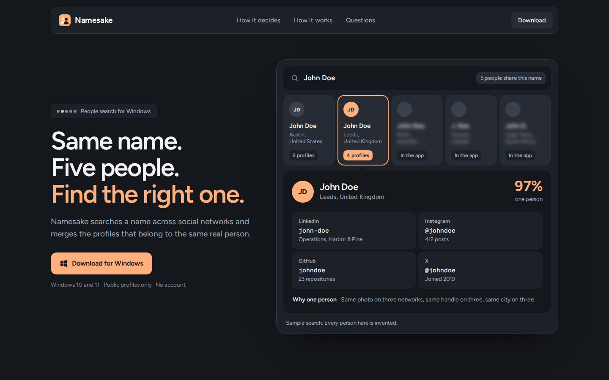
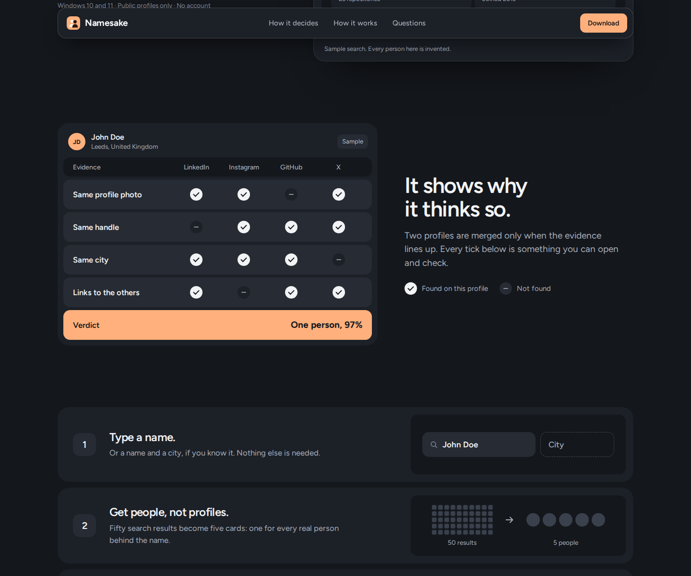
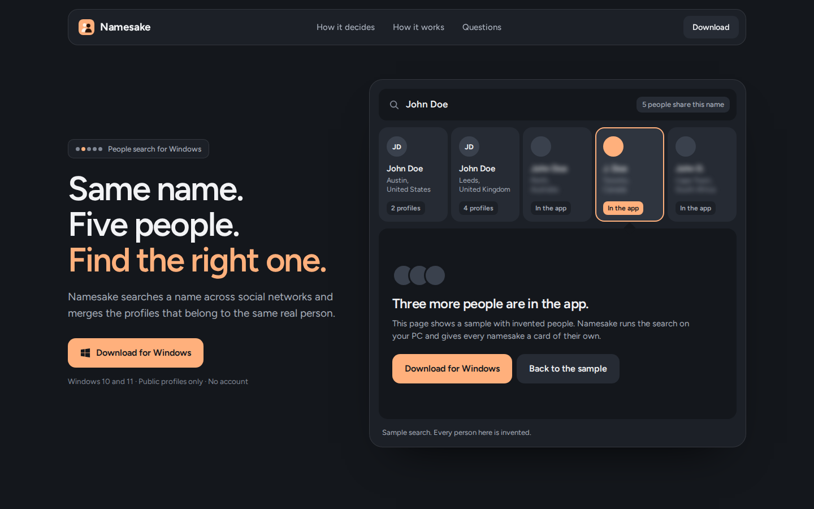

<h1 align="center">Namesake: OSINT people search across social networks</h1>

<b>Same name. Five people. Find the right one.</b> Search a name across social networks and tell the namesakes apart.

OSINT · OSINT tool · people search · name search · social media · SOCMINT · investigation · windows

> **Status: v2.3.2.** The app is out — [download Namesake for Windows](https://awesomeosint.tools/namesake/).

## Why this exists

Search a common name and you get five different people in one list. The profiles never say which of them is the one you are after.

## Why it is different

People-search sites list matches. Namesake merges the profiles that belong to the same person — avatars, bios, links — and keeps the namesakes apart.

## The idea

- **One object.** A row of people who share a name. One of them is the right one.
- **One number.** How sure it is that several profiles are one person.
- **Colour.** Slate `#14171C` and white. Apricot `#FFB07C` marks the right person and nothing else.
- **The main feature.** People, not profiles: search results are merged into one card per real person, with the evidence for every merge.

## The demo on the page

One sample name returns five people. Two can be opened: the card below shows their profiles on each network and why they were merged. The other three are blurred; clicking one shows the download instead.

